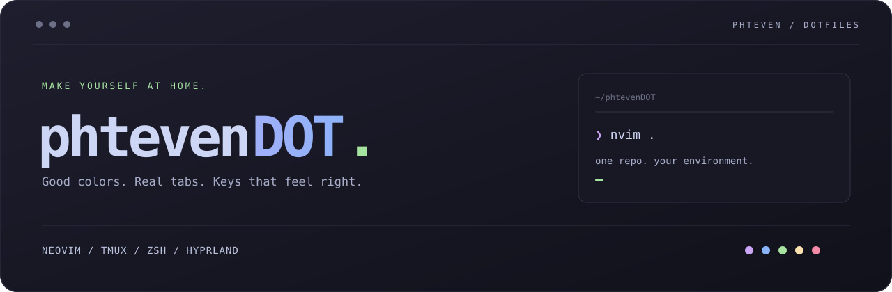
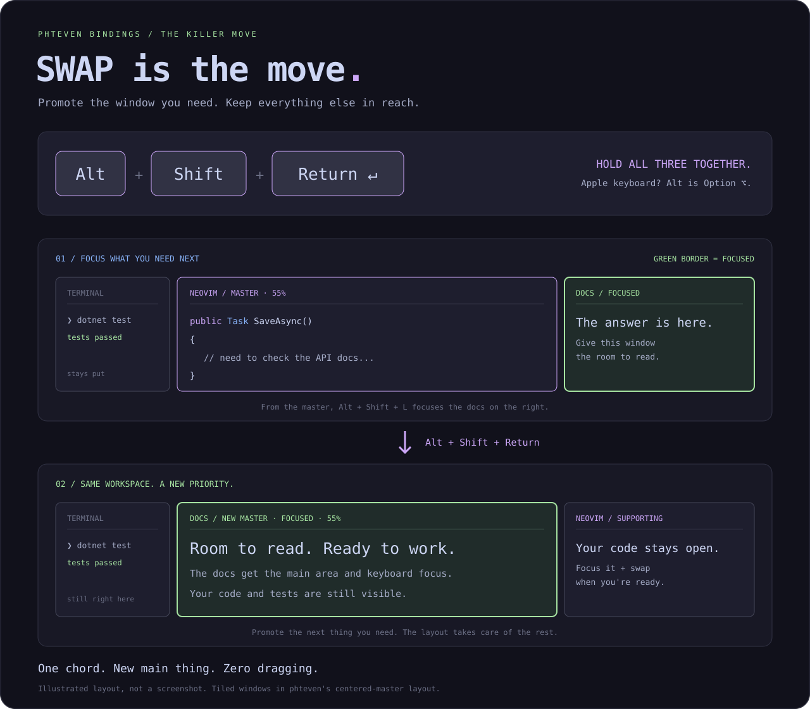

<div align="center">

**Sick configs by phteven. Make the workspace yours.**

[The killer move](#the-killer-move-swap) · [Bring it home](#bring-it-home) · [Theme modes](#your-theme-your-call) · [Starter guide](docs/field-guide.md) · [Agent guide](AGENTS.md)

</div>

## The killer move: Swap

Focus the window you need. Hold **Alt + Shift + Return**. It trades places with
the master and gets the main area **and keyboard focus**. Your previous main
window stays open beside it.



**Why it's sick:** your work changes priority constantly. Code, read the docs,
inspect a log, get back to code. Swap gives the next task room while keeping the
rest of your workspace in sight. One chord replaces the window-dragging ritual.

[Try the 60-second walkthrough →](docs/field-guide.md#swap-the-60-second-walkthrough)

## The configs

Mocha by default. Vim directions throughout. Real tabs. **phteven bindings**
for the window manager: inspired by Amethyst, shaped here, ready to grow.

| | What you get | Source → active path |
| --- | --- | --- |
| **Neovim** | LazyVim, C# tooling, fixed theme or Omarchy palette sync | [`nvim/`](nvim/) → `~/.config/nvim` |
| **tmux** | Rounded Mocha tabs, top status bar, Vim pane navigation | [`tmux/tmux.conf`](tmux/tmux.conf) → `~/.tmux.conf` |
| **Zsh** | Oh My Zsh, autosuggestions, syntax highlighting | [`zsh/zshrc`](zsh/zshrc) → `~/.zshrc` |
| **Prompt** | Powerlevel10k, Git status, contextual right prompt | [`zsh/p10k.zsh`](zsh/p10k.zsh) → `~/.p10k.zsh` |
| **macOS** | Homebrew and optional Toolbox paths | [`zsh/zprofile`](zsh/zprofile) → `~/.zprofile` |
| **phteven bindings** | Focus, Swap, resize, reset; centered master at 55% | [`config/hypr/`](config/hypr/) → matching files in `~/.config/hypr/` |

## Bring it home

Clone somewhere permanent:

```sh
git clone https://github.com/phteven7/phtevenDOT.git ~/phtevenDOT
```

Then give your agent this request:

> Integrate ~/phtevenDOT for this machine. Follow AGENTS.md, back up existing
> configs, and link the active paths to this checkout. Keep my machine-specific
> settings and verify that the applications load correctly.

Edit here; the active configs point back here. Keep the checkout in place.
Integration is guided by [`AGENTS.md`](AGENTS.md); this repo has no setup scripts.

**macOS & Linux:** Git, Neovim, tmux, Zsh, and a Nerd Font. Neovim also uses
ripgrep, fd, a C compiler, and gitui; C# tooling needs a .NET SDK. Upstream URLs,
expected paths, and known-working revisions live in [`dependencies.json`](dependencies.json).
Neovim installs its plugins from [`lazy-lock.json`](nvim/lazy-lock.json).

**Omarchy:** Window-manager bindings require a Lua-based Hyprland/Omarchy
installation with the `hl` and `o` APIs. They load after Omarchy's defaults.
Monitor, input, autostart, and VM settings stay with the host installation.

## Your theme. Your call.

Open **`:PhtevenTheme`** in Neovim to choose a mode. **Space → u → Shift + O**
toggles between them. The choice is saved on your machine, outside the repo.

| Mode | Behavior |
| --- | --- |
| **Fixed** | Keep your favorite installed colorscheme. Starts with transparent Catppuccin Mocha. |
| **Omarchy** | Feed the active system palette into Catppuccin's highlighting. Match the background, text, accents, and syntax colors; update while Neovim is open. |

```vim
:PhtevenTheme fixed
:PhtevenTheme fixed tokyonight-night
:PhtevenTheme omarchy
:PhtevenTheme status
```

Auto mode reads Omarchy's `colors.toml` from its current theme directory in the
XDG state or config location. It checks every two seconds and on focus changes.
Both dark and light palettes work. If no usable palette exists at startup, it
uses the fixed theme; interrupted theme changes keep the last good palette.
It follows the colors through Catppuccin, rather than loading Omarchy's separate
Neovim plugin spec. [Omarchy's palette format](https://github.com/omacom/omarchy/blob/quattro/docs/theming.md#colorstoml).

## Learn the flow

Start with [the visual field guide](docs/field-guide.md): Swap, directional
focus, the difference between held chords and tmux's prefix, Neovim basics,
and a few exercises to build muscle memory.

- **Window manager:** Alt + Shift + H/J/K/L focuses; Return swaps with master.
- **tmux:** Ctrl + Space, release, then h/j/k/l focuses a pane.
- **Neovim:** h/j/k/l moves the cursor in Normal mode; Space opens the leader menu.

Real tabs are the editor default: two columns normally, four for C#. Project
EditorConfig and formatter rules take precedence. CSharpier projects should set
[`"useTabs": true`](https://csharpier.com/docs/Configuration) when formatted C#
should keep tabs too.

---

Made by **phteven**. phteven bindings started with inspiration from
[Amethyst](https://github.com/ianyh/Amethyst) and Vim's directional keys;
the collection evolves here. The current window bindings target Omarchy/Hyprland.

Built on [LazyVim](https://github.com/LazyVim/LazyVim),
[Catppuccin](https://github.com/catppuccin),
[Oh My Zsh](https://github.com/ohmyzsh/ohmyzsh), and
[Powerlevel10k](https://github.com/romkatv/powerlevel10k).
Neovim's inherited [Apache 2.0 license](nvim/LICENSE) is preserved.
