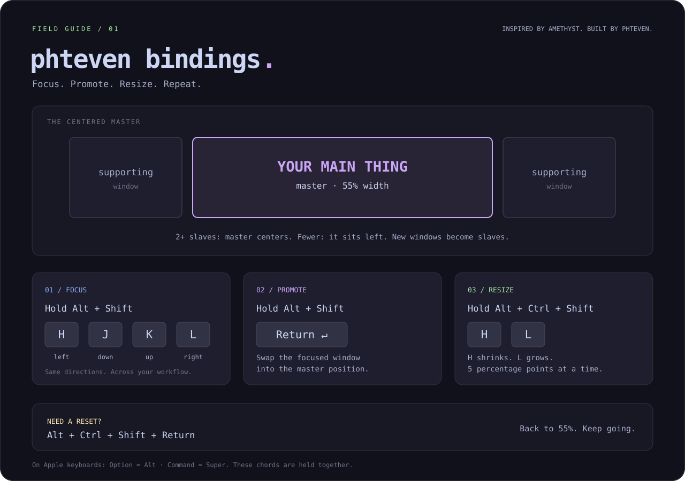
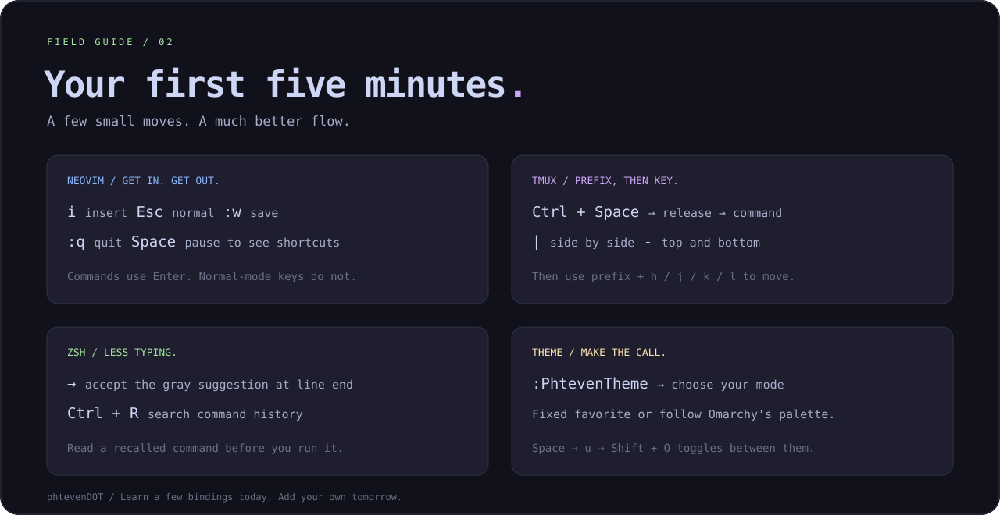

# The phteven field guide

[← Back to the configs](../README.md)

Start with Swap. The rest of these keys make it faster to choose what you want
to swap into the main area.

## Swap: the 60-second walkthrough

Open three tiled windows: your editor, a terminal, and documentation in a
browser. The editor can start in the centered master position.

1. **Pick the next main thing.** From the center, hold Alt + Shift and press L
   to focus the documentation window on the right. You can also click it.
2. **Swap.** Hold Alt + Shift and press Return. The focused docs trade places
   with the editor and get the main area and keyboard focus.
3. **Do the work.** Read the page at a useful width. Your editor and terminal
   remain visible alongside it.
4. **Go back to code.** Focus the editor in its supporting position, then use
   Alt + Shift + Return again. The editor becomes the master again.

On Apple keyboards, Alt is **Option**. These modifiers are held together;
they are not a sequence like tmux's prefix.

### Why it's sick af

The important window changes as you work. You might spend ten minutes writing
code, thirty seconds checking a reference, then a minute reading test output.
Swap gives each task the main workspace when you need it. The other windows
stay open and visible, so the context is already there when you come back.

Try **editor → docs → terminal → editor**. Focus the next window, swap it in,
and do the next thing. Once that loop becomes muscle memory, rearranging windows
stops being a separate task.

**Swap follows focus.** With `swapwithmaster master`, focus lands on the new
master. If you invoke it while the master is already focused, Hyprland swaps
with the first supporting window. To promote a particular window, focus that
window first. [Hyprland's layout behavior](https://wiki.hypr.land/Configuring/Layouts/Master-Layout/#layout-messages).

## The four moves

| Hold | Press | Result |
| --- | --- | --- |
| Alt + Shift | H / J / K / L | Focus left / down / up / right |
| Alt + Shift | Return | Swap the focused window with master |
| Alt + Ctrl + Shift | H / L | Shrink / grow master by 5 percentage points |
| Alt + Ctrl + Shift | Return | Reset the master to 55% width |

H is left, J is down, K is up, L is right. Learn those four directions once and
use them for cursor movement, pane navigation, and window focus.

The master centers with at least two supporting windows. With fewer, it moves
to the left. New windows enter the supporting stack. The layout diagram shows
a simple three-window workspace; more windows share the side areas.

**Try it:** Swap a terminal into the master, grow it twice, then reset. You now
know the entire window-management loop without touching the mouse.

## Your first five minutes

### Neovim: the essentials

- Press **i** to type. Press **Esc** to return to Normal mode.
- In Normal mode, enter **`:w` + Enter** to save, **`:q` + Enter** to quit,
  or **`:wq` + Enter** to save and quit. `:q` asks you to save unsaved changes.
- Press **Space** and pause in Normal mode to discover LazyVim's leader menu.
- **Space b n / Space b p** cycles through buffers in this config.
- Select lines with **V**, then use **J / K** to move them or **< / >** to indent
  while keeping the selection. **Esc** clears search highlighting in Normal mode.

### tmux: prefix, release, command

Press **Ctrl + Space**, release both keys, then press the command key. The
prefix tells tmux that the next key belongs to it instead of your shell.

| After the prefix | Action |
| --- | --- |
| `\|` / `-` | Split side by side / top and bottom |
| h / j / k / l | Focus a pane |
| H / J / K / L | Resize a pane |
| , / $ | Rename the window / session |
| r | Reload the config |

**Try it:** Split with prefix then `|`. Run a command in each pane. Move between
them with prefix then h/l. Mouse support and Vim copy mode are enabled too.

### Zsh: use your history

At the end of a command line, **Right Arrow** accepts the gray autosuggestion.
**Ctrl + R** searches command history. Read the suggested or recalled command
before pressing Enter. Your history is local; it isn't shipped in this repo.

### Theme: fixed favorite or follow the system

Run **`:PhtevenTheme` + Enter** to open the mode picker. Choose **Fixed** to keep
your installed colorscheme or **Omarchy** to follow the active system palette.
**Space → u → Shift + O** toggles the mode from Normal mode.

Want a specific permanent theme? Run **`:PhtevenTheme fixed tokyonight-night`**,
or substitute another installed colorscheme. The fixed choice is remembered
while you use auto mode. Switching back restores it.

Your choice lives in Neovim's state directory at `phteven/theme.json`, so two
people can share this repo without sharing theme preferences. Omarchy auto mode
adapts Catppuccin's rendering to the system's palette, including light themes.
It doesn't replace your shell prompt or tmux theme.

## Make them yours

The window bindings live in [`config/hypr/bindings.lua`](../config/hypr/bindings.lua).
The layout lives in [`looknfeel.lua`](../config/hypr/looknfeel.lua). Change one
thing at a time, check shortcut conflicts, then run `hyprctl reload` and
`hyprctl configerrors` on Omarchy. Keep the action labels and this guide in sync.

Inspired by Amethyst. Built and extended by phteven. Bring your own workflow.
